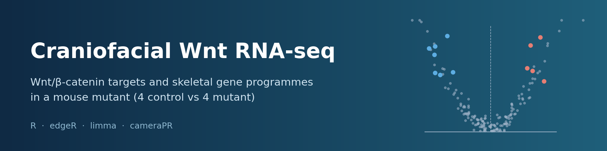
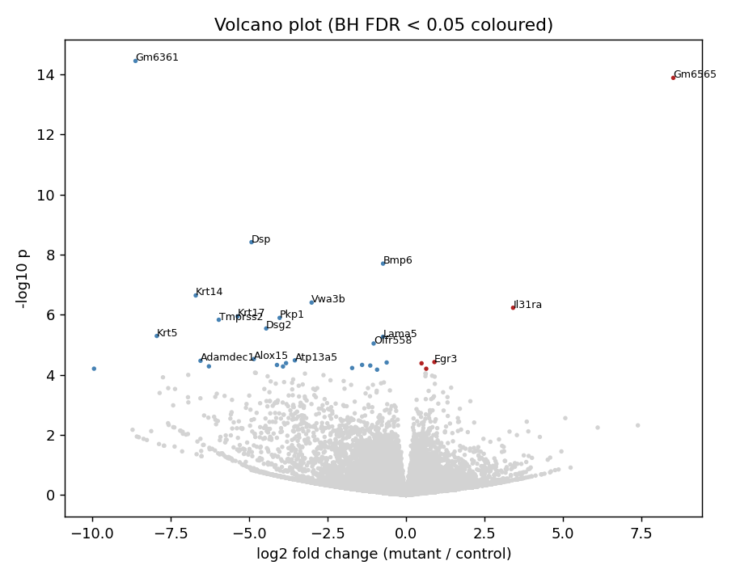
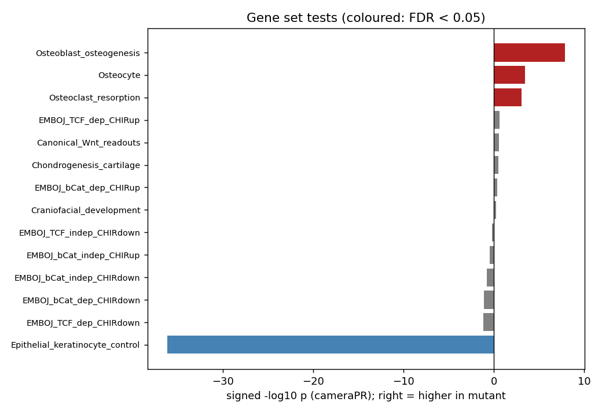
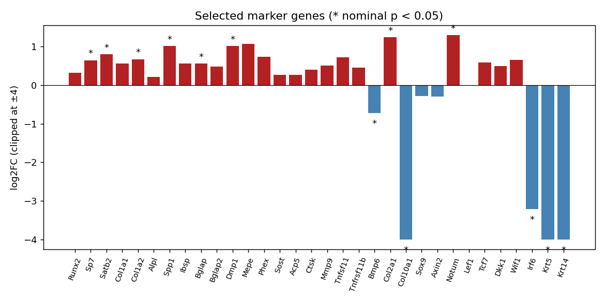
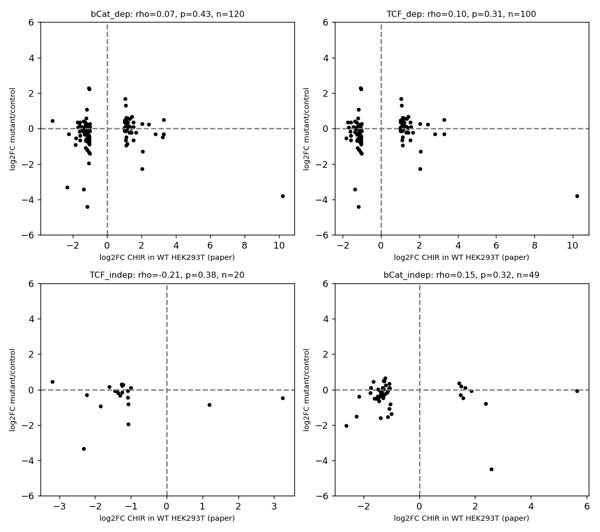

<p align="center">
  
</p>

<p align="center">
  
  
  
  
  
  
  
</p>

# Craniofacial / skeletal RNA-seq: Wnt/β-catenin target analysis

Analysis of a mouse RNA-seq experiment (4 control vs 4 mutant) for craniofacial,
cartilage, bone and osteogenic gene programmes, and for the Wnt/β-catenin target
genes defined by Doumpas et al., *EMBO J* 2019, which separates targets that
depend on the TCF/LEF transcription factors from those that do not.

> **Status.** The input file contains DESeq2 *results*, not raw counts, so the
> analysis currently works at the level of gene statistics. A full edgeR
> count-level pipeline is included and runs automatically once raw counts are
> added (see [Next steps](#8-next-steps)).

## Contents

1. [Key findings](#1-key-findings)
2. [Data](#2-data)
3. [Repository layout](#3-repository-layout)
4. [Installation and usage](#4-installation-and-usage)
5. [Methods](#5-methods)
6. [Results](#6-results)
7. [Limitations](#7-limitations)
8. [Next steps](#8-next-steps)
9. [Reference and citation](#9-reference-and-citation)

## 1. Key findings

| | Finding |
|---|---|
| 🧬 **Global DE** | 30 genes pass BH FDR < 0.05 (25 down, 5 up) out of 21,715 tested. |
| 🧫 **Strongest signal** | A coordinated loss of epithelial/keratinocyte genes (Krt5, Krt14, Krt17, Dsp, Pkp1), most likely reflecting differences in tissue composition. |
| 🦴 **Bone** | Osteoblast (FDR 1×10⁻⁷), osteocyte (FDR 0.002) and osteoclast (FDR 0.003) gene sets are modestly higher in the mutant (median log2FC ≈ +0.25 to +0.31). |
| 🔻 **Bmp6** | Significantly lower (log2FC −0.73, p = 2×10⁻⁸), against the trend of the osteoblast set. |
| 🦷 **Cartilage / craniofacial** | No overall shift in chondrogenesis or craniofacial patterning genes (Msx1/2, Dlx5, Twist1, Sox9). |
| 🔬 **Wnt/β-catenin** | No evidence of altered canonical Wnt output: none of the paper's TCF/LEF-dependent or -independent target sets is shifted, and Axin2, Lef1, Nkd1 and Dkk1 are unchanged. |

## 2. Data

| Input | Description |
|---|---|
| `DESeq2_results_4control_4mutant.csv` | DESeq2 output for 22,444 mouse genes. Columns: `gene_id`, `symbol`, `baseMean`, `log2FoldChange`, `pvalue`. No padj, standard errors or counts. |
| `wnt_targets_EMBOJ2018.xlsx` | Table EV1 of Doumpas et al. 2019: CHIR99021-regulated genes in HEK293T cells, split into β-catenin-independent (65), β-catenin-dependent (166), TCF/LEF-independent (27) and TCF/LEF-dependent (139). |
| `curated_skeletal_craniofacial_genesets.tsv` | Seven curated gene sets: canonical Wnt readouts, craniofacial development, chondrogenesis, osteoblast, osteocyte, osteoclast, and an epithelial control set. |

The very high expression of Col1a1, Col1a2, Spp1, Bglap, Ibsp, Dmp1, Ctsk and
Acp5 indicates that the samples are mineralised bone tissue.

Raw data files are kept out of git (`.gitignore`). See
[`data/raw/README.md`](data/raw/README.md) for where each file goes.

## 3. Repository layout

```
craniofacial-wnt-rnaseq/
├── R/
│   ├── 00_install_packages.R   install edgeR, limma, readxl
│   ├── utils.R                 paths, settings and helper functions
│   ├── 01_prepare_results.R    clean DESeq2 table, BH FDR, signed z-statistic
│   ├── 02_qc_plots.R           p-value histogram, MA plot, volcano
│   ├── 03_geneset_analysis.R   cameraPR gene set tests, concordance plots
│   ├── edgeR_from_counts.R     full edgeR QL pipeline (needs raw counts)
│   └── run_all.R               runs every step in order
├── data/
│   ├── raw/                    input files (git-ignored)
│   └── genesets/               curated gene sets
├── results/
│   ├── tables/                 generated CSV tables
│   └── figures/                generated PNG figures
├── report/
│   ├── report.md               full written report
│   └── figures/                figures used in the report
├── docs/                       banner and extra documentation
├── setup_github.fish           git init + push to a private GitHub repo
├── LICENSE
└── README.md
```

## 4. Installation and usage

**Requirements:** R ≥ 4.3 and Bioconductor (edgeR, limma), plus readxl from CRAN.

```sh
git clone https://github.com/mtariqi/craniofacial-wnt-rnaseq.git
cd craniofacial-wnt-rnaseq

# 1. Place the input files in data/raw/ (see data/raw/README.md)

# 2. Install packages (once)
Rscript R/00_install_packages.R

# 3. Run the full analysis
Rscript R/run_all.R
```

Outputs are written to `results/tables/` and `results/figures/`. If
`data/raw/counts.csv` and `data/raw/samples.csv` are present, `run_all.R` also
runs the edgeR count-level pipeline.

| Output | Contents |
|---|---|
| `results/tables/DE_genes_BH05.csv` | Genes with BH FDR < 0.05 |
| `results/tables/geneset_cameraPR.csv` | Gene set test results (main table) |
| `results/tables/geneset_mapping.csv` | How many genes of each set were found in the data |
| `results/tables/set_*.csv` | Per-gene statistics for each gene set |
| `results/figures/01–07_*.png` | QC, volcano, gene set and concordance plots |

## 5. Methods

1. **Cleaning.** Genes without a symbol or p-value were removed. For 39 duplicated symbols, the most significant row was kept, leaving 21,715 genes.
2. **FDR.** Benjamini–Hochberg adjustment across all tested genes. This can differ slightly from DESeq2's own padj, which applies independent filtering.
3. **Signed statistic.** z = sign(log2FC) × Φ⁻¹(1 − p/2), which combines the direction and strength of each gene's change.
4. **Wnt target sets.** Each Table EV1 list was split into genes induced or repressed by CHIR in wild-type HEK293T cells. Human symbols were matched to mouse symbols case-insensitively (AXIN2 → Axin2), recovering 55–85% of each list.
5. **Gene set tests.** `limma::cameraPR` (competitive test, inter-gene correlation 0.01), then BH correction across sets.
6. **Concordance.** Spearman correlation between the paper's CHIR log2FC and the mutant log2FC for each Table EV1 list.

## 6. Results

### 6.1 Global differential expression

<p align="center"></p>

1,334 genes have p < 0.05, against about 1,086 expected by chance, so the
signal is real but modest. The 25 significantly downregulated genes are
dominated by epithelial and keratinocyte genes: Krt5 (−7.9), Krt14 (−6.7),
Krt17 (−5.4), Dsp (−4.9), Pkp1 (−4.0), Dsg2 (−4.5), Tacstd2 (−3.8), together
with Tmprss2 and Bpifb3. Smaller but highly significant decreases include Bmp6,
Lama5, Mtor and Rgs5. The upregulated genes are Gm6565, Il31ra, Egr3, Tarbp1 and
Zfp709. The predicted genes Gm6361 (−8.6) and Gm6565 (+8.5) change strongly in
opposite directions and should be checked for mapping or strain-background
effects.

The epithelial genes change as a block by 16- to 250-fold at low expression.
The simplest explanation is more epithelium in the control dissections, although
a genuine loss of epithelium in the mutant (Irf6 −3.2, Cdh1 −2.6) cannot be
ruled out without per-sample data.

### 6.2 Skeletal, osteogenic and craniofacial gene sets

<p align="center"></p>

| Gene set | Genes | Direction | p | FDR | Median log2FC | Fraction up |
|---|---|---|---|---|---|---|
| Epithelial/keratinocyte (control) | 23 | Down | 7.3×10⁻³⁷ | 1.0×10⁻³⁵ | −3.63 | 0% |
| Osteoblast/osteogenesis | 34 | Up | 1.4×10⁻⁸ | 9.8×10⁻⁸ | +0.31 | 85% |
| Osteocyte | 9 | Up | 3.8×10⁻⁴ | 0.0018 | +0.30 | 100% |
| Osteoclast/resorption | 16 | Up | 8.0×10⁻⁴ | 0.0028 | +0.25 | 88% |
| Chondrogenesis/cartilage | 27 | Up | 0.33 | 0.43 | −0.03 | 48% |
| Canonical Wnt readouts | 16 | Up | 0.28 | 0.43 | +0.03 | 56% |
| Craniofacial development | 54 | Up | 0.60 | 0.61 | +0.02 | 56% |

<p align="center"></p>

- **Osteoblast genes** are modestly higher, including Spp1 (+1.01), Satb2 (+0.80), Col1a2 (+0.67), Sp7 (+0.65), Bglap (+0.56) and Omd (+0.52). Bmp6 is the clear exception, at −0.73.
- **Osteocyte genes** are all higher, led by Dmp1 (+1.02) and Mepe (+1.07).
- **Osteoclast genes** are mostly higher (Tnfsf11/RANKL +0.72, Mmp9 +0.51, Ctsk +0.40), but none individually significant. The RANKL/OPG balance is unchanged.
- **Cartilage and craniofacial patterning genes** show no overall shift. Col10a1 (−4.1) and Sox5 (−0.46) are down, while Col2a1 (+1.24) and Matn3 (+1.12) are up.

Because osteoblast, osteocyte and osteoclast genes all rise by a similar small
amount, the pattern fits more mineralised bone per sample, which matches the
lower epithelial signal. It is less consistent with a specific boost in
osteoblast differentiation. The drop in Bmp6 runs against this trend, which makes
it the more specific candidate.

### 6.3 Wnt/β-catenin targets (Doumpas et al. 2019)

| Paper set (mouse-matched) | Genes | Direction | p | FDR | Median log2FC |
|---|---|---|---|---|---|
| TCF/LEF-dependent, CHIR-down | 60 | Down | 0.068 | 0.19 | −0.12 |
| β-catenin-dependent, CHIR-down | 78 | Down | 0.086 | 0.20 | −0.12 |
| β-catenin-independent, CHIR-down | 40 | Down | 0.17 | 0.34 | −0.22 |
| TCF/LEF-dependent, CHIR-up | 40 | Up | 0.24 | 0.41 | +0.04 |
| β-catenin-independent, CHIR-up | 9 | Down | 0.34 | 0.43 | −0.08 |
| β-catenin-dependent, CHIR-up | 42 | Up | 0.42 | 0.49 | +0.02 |
| TCF/LEF-independent, CHIR-down | 18 | Down | 0.61 | 0.61 | −0.13 |

<p align="center"></p>

None of the paper's target sets is significantly shifted, and the mutant fold
changes do not correlate with the paper's CHIR response (Spearman ρ between
−0.21 and 0.15, all p > 0.3). Classic direct targets are unchanged: Axin2
(−0.30), Lef1 (0.0), Nkd1 (−0.32), Apcdd1 (−0.65) and Dkk1 (+0.50), none
significant. Only Notum shows a nominal increase (+1.30, p = 0.03). The TCF/LEF
genes, Ctnnb1, the FOXO factors and the GADD45 genes linked to the paper's
TCF-independent "GHOST" response are all unchanged.

At the level of bulk tissue, there is no evidence that the mutation alters
canonical TCF/LEF-mediated Wnt/β-catenin transcription or engages the
TCF/LEF-independent targets.

## 7. Limitations

- **No raw counts.** edgeR cannot be run on DESeq2 results, so dispersion estimation and sample-level checks are not yet possible.
- **Different systems.** The paper's target lists come from human HEK293T cells treated with CHIR99021 for 24 hours. Wnt targets are strongly cell-type specific and may not transfer to mouse bone in vivo.
- **Ortholog matching.** Case-insensitive symbol matching misses lncRNAs, antisense transcripts and renamed orthologs.
- **Power.** With 4 samples per group and bulk tissue, changes in small cell populations (such as suture or periosteal cells) can be diluted below detection.
- **Test assumptions.** cameraPR on summary statistics assumes a fixed inter-gene correlation, which overstates significance for strongly co-regulated blocks such as the epithelial genes.

## 8. Next steps

1. **Add raw counts.** Save the count matrix as `data/raw/counts.csv` and a sample sheet (`sample,group`, plus `sex`, `litter` or `batch` if known) as `data/raw/samples.csv`, then rerun `Rscript R/run_all.R`. This runs edgeR (`filterByExpr`, TMM, `estimateDisp`, `glmQLFit`/`glmQLFTest`, `glmTreat`) and sample-level `camera`/`fry` gene set tests.
2. **Check tissue composition per sample,** comparing epithelial markers (Krt5, Krt14, Bpifb3) with bone markers (Col1a1, Bglap, Dmp1).
3. **Confirm the mutant allele** in the counts and investigate the Gm6361/Gm6565 pair.
4. **Run unbiased enrichment** with `limma::goana`/`kegga` and a proper mouse–human ortholog table.
5. **Validate candidates** (Bmp6, Sp7, Dmp1, Spp1, Notum) by qPCR or in situ hybridisation, alongside histology or micro-CT.

The full write-up is in [`report/report.md`](report/report.md).

## 9. Reference and citation

Doumpas N, Lampart F, Robinson MD, Lentini A, Nestor CE, Cantù C, Basler K.
TCF/LEF dependent and independent transcriptional regulation of Wnt/β-catenin
target genes. *EMBO J.* 2019;38:e98873.
[doi:10.15252/embj.201798873](https://doi.org/10.15252/embj.201798873)

Robinson MD, McCarthy DJ, Smyth GK. edgeR: a Bioconductor package for
differential expression analysis of digital gene expression data.
*Bioinformatics.* 2010;26:139–140.

Ritchie ME, Phipson B, Wu D, et al. limma powers differential expression
analyses for RNA-sequencing and microarray studies. *Nucleic Acids Res.*
2015;43:e47.

---

<sub>Code released under the [MIT License](LICENSE). Data remain the property of the originating laboratory and are not included in this repository.</sub>
