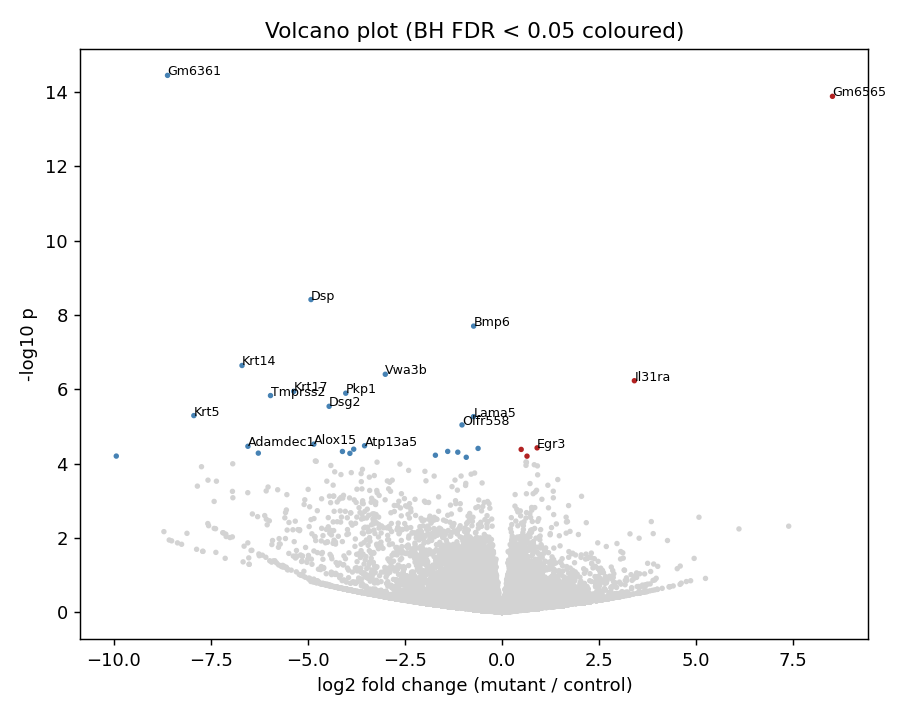
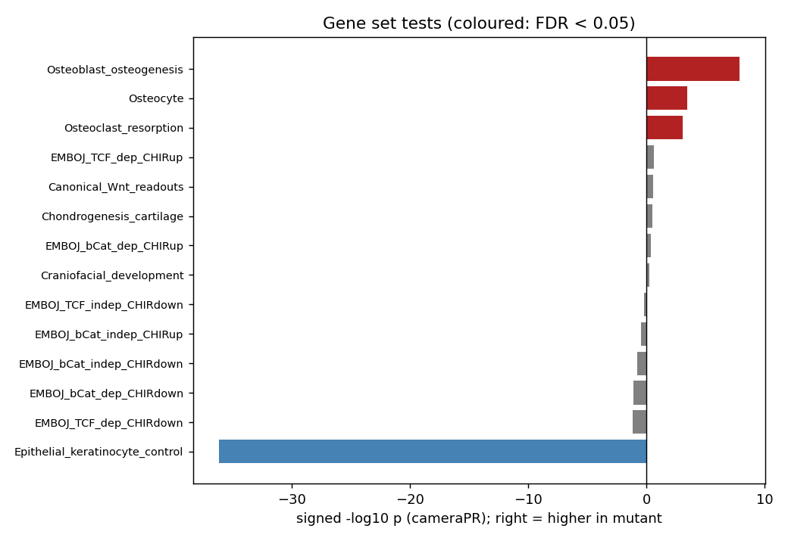
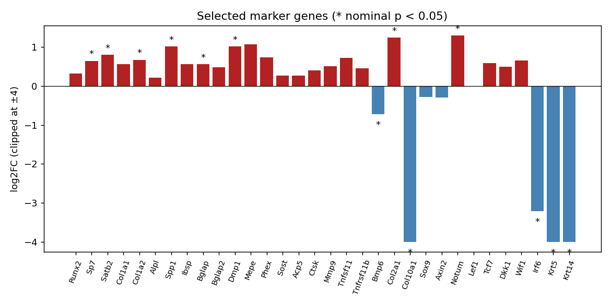
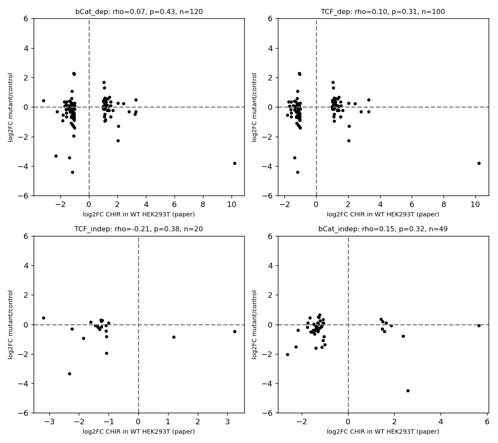

# Wnt/β-catenin targets and skeletal gene programmes in the mutant vs control RNA-seq

**Data:** DESeq2 results, mouse, 4 control vs 4 mutant (`DESeq2_results_RECALCULATE_4control_4mutant-20251023_TM.csv`)
**Reference gene sets:** Table EV1 of Doumpas et al., *EMBO J* 2019;38:e98873
**Status:** results-level analysis. The edgeR count-level analysis is ready in `R/edgeR_from_counts.R` but needs the raw count matrix.

## 1. Summary

The mutant shows a modest transcriptional change: 30 genes pass BH FDR < 0.05, and most of them (25) are lower in the mutant. The strongest signal is a coordinated loss of epithelial and keratinocyte genes (Krt5, Krt14, Krt17, Dsp, Pkp1, Dsg2, Tacstd2), which looks more like a difference in tissue composition than a skeletal phenotype. Bone-cell gene sets are shifted upward together, with osteoblast, osteocyte and osteoclast markers all modestly higher (median log2FC about +0.25 to +0.31), while cartilage and craniofacial patterning genes are unchanged. There is no evidence that canonical Wnt/β-catenin transcriptional output is altered: none of the paper's TCF/LEF-dependent or -independent target sets, and none of the classic Wnt readouts, are significantly shifted.

## 2. Input data and what it allows

The results file contains 22,444 Ensembl mouse genes with baseMean, log2 fold change and raw p-value. It has no adjusted p-value, no standard errors and no sample-level counts. After removing genes without a symbol or p-value and keeping the most significant row for 39 duplicated symbols, 21,715 genes remain.

The expression profile indicates mineralised bone tissue. Col1a1 (baseMean ≈ 1.1 million), Col1a2, Spp1, Bglap, Ibsp, Dmp1, Ctsk and Acp5 are among the most abundant transcripts. Please confirm the tissue, age and genotype of the mutant, because these determine which interpretations below are plausible.

edgeR works on raw counts. It estimates dispersions from the replicate samples and fits negative binomial models, so it cannot be applied to a table of DESeq2 results. For this reason the present analysis uses a signed z-statistic derived from each gene's p-value and fold-change direction, and tests gene sets with `limma::cameraPR`, which comes from the same Bioconductor family as edgeR. When the counts are available, `R/edgeR_from_counts.R` runs the full edgeR quasi-likelihood pipeline: `filterByExpr`, TMM normalisation, `estimateDisp`, `glmQLFit`/`glmQLFTest`, a `glmTreat` fold-change threshold test, and `camera`/`fry` gene set tests on the samples themselves.

## 3. Methods

1. **FDR.** Benjamini–Hochberg adjustment over all 21,715 tested genes. This can differ slightly from DESeq2's own padj, which applies independent filtering.
2. **Signed statistic.** z = sign(log2FC) × Φ⁻¹(1 − p/2).
3. **Wnt target sets.** The four gene lists from Table EV1 (β-catenin-independent, β-catenin-dependent, TCF/LEF-independent, TCF/LEF-dependent) were each split into genes induced or repressed by CHIR in wild-type HEK293T cells. Human symbols were matched to mouse symbols case-insensitively (AXIN2 → Axin2).
4. **Curated sets.** Canonical Wnt readouts; craniofacial development; chondrogenesis/cartilage; osteoblast/osteogenesis; osteocyte; osteoclast/resorption; and an epithelial/keratinocyte set as a tissue-composition control. These are listed in `data/genesets/`.
5. **Gene set test.** `cameraPR` with an assumed inter-gene correlation of 0.01, which is the limma default, followed by BH correction across sets.
6. **Concordance.** Spearman correlation between the paper's CHIR log2FC in wild-type cells and the mutant log2FC, for each Table EV1 list.

Symbol matching recovered 55–85% of each paper list. The losses are mostly lncRNAs, antisense transcripts and primate-specific genes. The TCF/LEF-independent CHIR-induced list has only 2 matched genes, so it could not be tested.

| Paper list (CHIR direction in WT) | Human genes | Matched in mouse data |
|---|---|---|
| β-catenin-dependent, up | 71 | 42 |
| β-catenin-dependent, down | 95 | 78 |
| TCF/LEF-dependent, up | 67 | 40 |
| TCF/LEF-dependent, down | 72 | 60 |
| TCF/LEF-independent, up | 4 | 2 |
| TCF/LEF-independent, down | 23 | 18 |
| β-catenin-independent, up | 10 | 9 |
| β-catenin-independent, down | 55 | 40 |

## 4. Results

### 4.1 Global differential expression

Of the 21,715 genes tested, 1,334 have p < 0.05. About 1,086 would be expected by chance, so there is some real signal, but it is modest. At BH FDR < 0.05, 30 genes are significant: 25 lower and 5 higher in the mutant.

The downregulated genes fall into three groups. The largest is epithelial and keratinocyte genes: Krt5 (log2FC −7.9), Krt14 (−6.7), Krt17 (−5.4), Dsp (−4.9), Pkp1 (−4.0), Dsg2 (−4.5) and Tacstd2 (−3.8), along with Tmprss2 (−6.0) and Bpifb3 (−9.9, a secretory protein of airway and nasal epithelium). A second group is signalling and growth genes with small but highly significant decreases: Bmp6 (−0.73, p = 2×10⁻⁸), Lama5 (−0.73), Mtor (−0.61) and Rgs5 (−0.92). The third is a pair of predicted genes, Gm6361 (−8.6) and Gm6565 (+8.5), which change by very large amounts in opposite directions.

The five upregulated genes are Gm6565, Il31ra (+3.4), Egr3 (+0.91), Tarbp1 (+0.50) and Zfp709 (+0.65).

The epithelial genes change by 16- to 250-fold as a coordinated block, and they are expressed at low levels in this bone-rich tissue. The simplest explanation is that the control samples contained more epithelium, such as oral, nasal or skin tissue carried over during dissection, or that one or two samples contained a lot of it. Irf6 (−3.2) and Cdh1 (−2.6) belong to the same block. Irf6 is a craniofacial and cleft gene, so a genuine loss of epithelium in the mutant can't be excluded. This question can only be settled with the per-sample counts. The Gm6361/Gm6565 pair should also be checked for mapping or strain-background effects, for example sequence differences near the targeted locus.

### 4.2 Skeletal, osteogenic and craniofacial gene sets

| Gene set | Genes | Direction | cameraPR p | FDR | Median log2FC | Fraction up |
|---|---|---|---|---|---|---|
| Epithelial/keratinocyte (control) | 23 | Down | 7.3×10⁻³⁷ | 1.0×10⁻³⁵ | −3.63 | 0% |
| Osteoblast/osteogenesis | 34 | Up | 1.4×10⁻⁸ | 9.8×10⁻⁸ | +0.31 | 85% |
| Osteocyte | 9 | Up | 3.8×10⁻⁴ | 0.0018 | +0.30 | 100% |
| Osteoclast/resorption | 16 | Up | 8.0×10⁻⁴ | 0.0028 | +0.25 | 88% |
| Chondrogenesis/cartilage | 27 | Up | 0.33 | 0.43 | −0.03 | 48% |
| Canonical Wnt readouts | 16 | Up | 0.28 | 0.43 | +0.03 | 56% |
| Craniofacial development | 54 | Up | 0.60 | 0.61 | +0.02 | 56% |

**Osteoblast/osteogenesis.** Most genes in this set are modestly higher in the mutant. Nominally significant ones include Spp1 (+1.01), Satb2 (+0.80), Col1a2 (+0.67), Sp7/Osterix (+0.65), Ank (+0.64), Bglap (+0.56) and Omd (+0.52). Runx2 (+0.32), Col1a1 (+0.57) and Ibsp (+0.56) move in the same direction without reaching nominal significance. The clear exception is Bmp6, which is significantly lower (−0.73) against the trend of the set.

**Osteocyte.** All nine genes are higher in the mutant, led by Dmp1 (+1.02, p = 0.03) and Mepe (+1.07, p = 0.05).

**Osteoclast/resorption.** Fourteen of 16 genes are higher (Tnfsf11/RANKL +0.72, Mmp9 +0.51, Ctsk +0.40), but none is individually significant. The Tnfsf11/Tnfrsf11b (RANKL/OPG) balance is essentially unchanged, as both rise by similar amounts.

**Cartilage and craniofacial patterning.** Neither set shows an overall shift. Individual genes vary in both directions: Col10a1 (−4.1, p = 0.0008, a hypertrophic chondrocyte marker with low expression), Sox5 (−0.46), Col2a1 (+1.24) and Matn3 (+1.12). Key patterning transcription factors are unchanged, including Msx1, Msx2, Dlx5, Twist1, Sox9, Alx and Prrx genes.

**Interpretation.** Osteoblast, osteocyte and osteoclast genes rise together by a similar small amount. This pattern is what you would expect if each mutant sample contained proportionally more mineralised bone and less soft tissue, which fits the lower epithelial signal. It is less consistent with a specific increase in osteoblast differentiation, which would typically raise osteoblast genes more than osteoclast genes. Both explanations fit these data, and they can be distinguished with per-sample counts (section 5). The decrease in Bmp6 goes against the composition trend, which makes it a more specific candidate. If histology or micro-CT show increased bone in the mutant, the osteogenic shift is also worth following up in its own right.

### 4.3 Wnt/β-catenin targets from Doumpas et al.

| Paper set (mouse matched) | Genes | Direction | p | FDR | Median log2FC |
|---|---|---|---|---|---|
| TCF/LEF-dependent, CHIR-down | 60 | Down | 0.068 | 0.19 | −0.12 |
| β-catenin-dependent, CHIR-down | 78 | Down | 0.086 | 0.20 | −0.12 |
| β-catenin-independent, CHIR-down | 40 | Down | 0.17 | 0.34 | −0.22 |
| TCF/LEF-dependent, CHIR-up | 40 | Up | 0.24 | 0.41 | +0.04 |
| β-catenin-independent, CHIR-up | 9 | Down | 0.34 | 0.43 | −0.08 |
| β-catenin-dependent, CHIR-up | 42 | Up | 0.42 | 0.49 | +0.02 |
| TCF/LEF-independent, CHIR-down | 18 | Down | 0.61 | 0.61 | −0.13 |

None of the paper's target sets is significantly shifted, and the mutant fold changes don't correlate with the paper's CHIR response. The Spearman correlations are ρ = 0.07 for β-catenin-dependent genes, 0.10 for TCF/LEF-dependent, −0.21 for TCF/LEF-independent and 0.15 for β-catenin-independent, and all p-values are above 0.3. The classic direct targets are unchanged or show only nominal changes: Axin2 (−0.30, p = 0.13), Lef1 (0.0), Nkd1 (−0.32), Apcdd1 (−0.65, p = 0.16), Lgr5 (−0.91, p = 0.17) and Dkk1 (+0.50, p = 0.26). Sp5 is barely expressed. Notum (+1.30, p = 0.03) is the only Wnt readout with a nominal change, and on its own it isn't evidence of a pathway change. The TCF/LEF genes themselves (Tcf7, Tcf7l1, Tcf7l2, Lef1), Ctnnb1, and the FOXO factors and GADD45 genes the paper links to the TCF-independent "GHOST" response are all unchanged.

The two CHIR-repressed sets trend slightly downward (p ≈ 0.07–0.09). This is not significant after correction, and it would point towards slightly higher Wnt activity in the mutant, whereas the CHIR-induced sets show no matching increase. It is best treated as a trend worth rechecking with count-level tests.

**Interpretation.** At the level of bulk tissue, this dataset provides no evidence that the mutation changes canonical, TCF/LEF-mediated Wnt/β-catenin transcription, or that it engages the TCF/LEF-independent targets described by Doumpas et al. Three caveats limit how strongly this can be concluded:

1. **Different systems.** The paper's lists come from human HEK293T cells treated with the GSK3 inhibitor CHIR99021 for 24 hours. Wnt target genes are highly cell-type specific, and many HEK293T targets may simply not respond in skeletal tissue in vivo. The TCF/LEF-independent and GHOST responses were only observed after removing all four TCF/LEF genes, so they are the least likely to carry over.
2. **Power.** With four samples per group and bulk tissue, changes in a minority cell population, such as Wnt-responsive suture mesenchyme or periosteal cells, can be diluted below detection.
3. **Method.** cameraPR on a summary statistic assumes a fixed inter-gene correlation. For strongly co-regulated blocks, such as the epithelial genes, this overstates significance; the very small p-value for that set should be read as "very strong", not taken literally. The count-level `camera` and `fry` tests in the edgeR script estimate this correlation from the samples.

## 5. Recommended next steps

1. **Provide the raw count matrix and a sample sheet** (with sex and litter, if known), then run `Rscript R/run_all.R`. This enables edgeR QL testing, an MDS plot, and camera/fry gene set tests on the samples.
2. **Check tissue composition sample by sample.** Plot the log-CPM of Krt5, Krt14 and Bpifb3, and of Col1a1, Bglap and Dmp1, for each sample. If one or two control samples carry most of the epithelial signal, consider excluding them or adding an epithelial score as a covariate, then re-test the bone sets.
3. **Confirm the mutant allele** in the counts (for example, reduced reads or missing exons at the targeted gene), and look into the Gm6361/Gm6565 pair.
4. **Use unbiased enrichment.** Run `limma::goana`/`kegga` on the edgeR results. This needs `org.Mm.eg.db` and internet access to install. Replace the case-matching ortholog step with a proper table, such as MGI's human–mouse homology report or biomaRt.
5. **Validate candidates** with qPCR or in situ hybridisation, starting with Bmp6, Sp7, Dmp1, Spp1 and Notum, together with histology or micro-CT to test whether mineralised bone is increased.

## 6. Reproducibility

The analysis code is in `R/`. It uses base R graphics with limma, edgeR and readxl. The figures and numbers in this report were generated with an equivalent Python implementation of the same steps: BH adjustment, the same z-statistic, and the cameraPR formula with inter-gene correlation 0.01. Running `R/run_all.R` should reproduce these numbers within rounding. Any differences would come from the Spearman tie handling or from how the Excel sheets are parsed.
